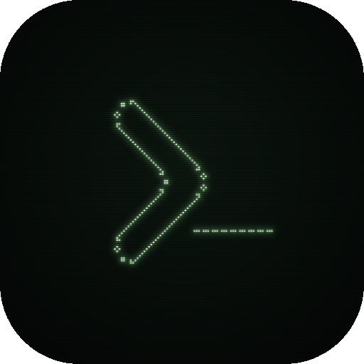
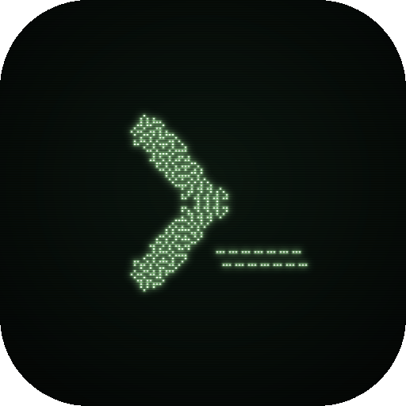
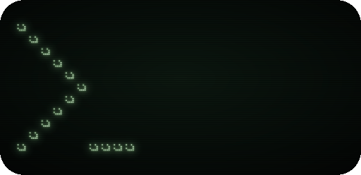
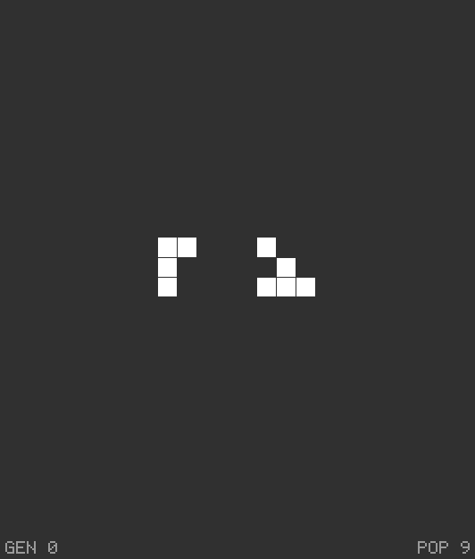
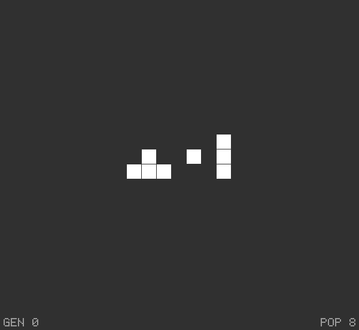

# Our patterns

Patterns made or found for destbreso.com, one file each, in RLE with a `#N` name line, a `#O` line for who made it and when, and `#C` lines saying what it is. Run `npm run index` after adding one and commit the index with it.

## The prompt, >_

destbreso.com's mark in Life, from the simplest to the most complex. Each chevron was found with a SAT solver (kissat) asked for the site mark's outline or its filled stroke, symmetric, still or alive and reading whole in every phase; each cursor is blinkers, so it blinks. Every one was checked in Golly's bgolly and is run by the index.

Their pictures are in [renders/destbreso](../../renders/destbreso): for each pattern a GIF of its generations, half a second each (the flying one a frame every 4 generations), a still PNG of its first, and for the ones that stay put an avatar PNG framed for a round crop, all in the site's terminal green (#a0e299) glowing on near-black. They were drawn outside this repository from the files here; a changed pattern needs its pictures drawn again.

| Pattern | What it is | Cells | Does | Picture |
|---|---|---:|---|---|
| [Blinking prompt, small](blinking-prompt-small.rle) | The smallest: a still chevron of 60 cells with a block at its tip, four blinkers for the cursor. | 72 | oscillator, 2 |  |
| [Blinking prompt](blinking-prompt.rle) | The chevron's outline in the fewest cells that trace it symmetrically, 116, still; seven blinkers. | 137 | oscillator, 2 |  |
| [Blinking prompt, large](blinking-prompt-large.rle) | The largest and smoothest: a still chevron of 146 cells, nine blinkers. | 173 | oscillator, 2 |  |
| [Blinking prompt, filled](blinking-prompt-filled.rle) | The stroke filled: a still chevron of 340 cells, every 3 by 3 square inside it with four or more; two rows of blinkers. | 382 | oscillator, 2 |  |
| [Living prompt](living-prompt.rle) | The chevron alive: 132 of its cells change every generation and its outline reads whole in both phases. | 157 | oscillator, 2 |  |
| [Living prompt, period 3](living-prompt-p3.rle) | A chevron of period 3 beside a cursor of period 2, so the whole repeats every 6. | 201 | oscillator, 6 |  |
| [Flying prompt](flying-prompt.rle) | Fifteen lightweight spaceships in the shape of >_, flying east together, seven cells apart. | 135 | ship, 4, (2, 0) |  |

## Methuselahs

Small patterns that live long before they settle, found on 2026-11-11 by searching around lavashard's 9-cell methuselah of 1151 generations in the ConwayLife Lounge: about 35,000 variants with cells added, removed or moved, each run in bgolly. They are a local best, not records (Rabbits and Bunnies 9 live past 17,000 generations with 9 cells, 7468M 7,468 with 8). The index runs a pattern for 2,048 generations, so it has them as still changing. Their GIFs, in [renders/destbreso](../../renders/destbreso), follow the pattern from its start out to the ash it leaves, its escaping gliders left to go, with the generation and the population under it.

| Pattern | What it is | Cells | Settles | Picture |
|---|---|---:|---|---|
| [Nine-cell methuselah, 5160](nine-cell-methuselah-5160.rle) | 9 cells in 8 by 3: lavashard's with three cells moved | 9 | at 5160, into 571 cells and 10 gliders |  |
| [Eight-cell methuselah, 4920](eight-cell-methuselah-4920.rle) | 8 cells in 7 by 3 | 8 | at 4920, into 704 cells and 15 gliders |  |
